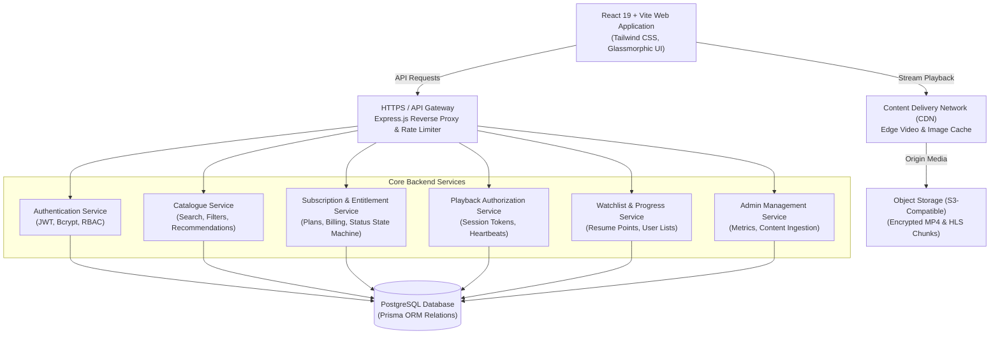
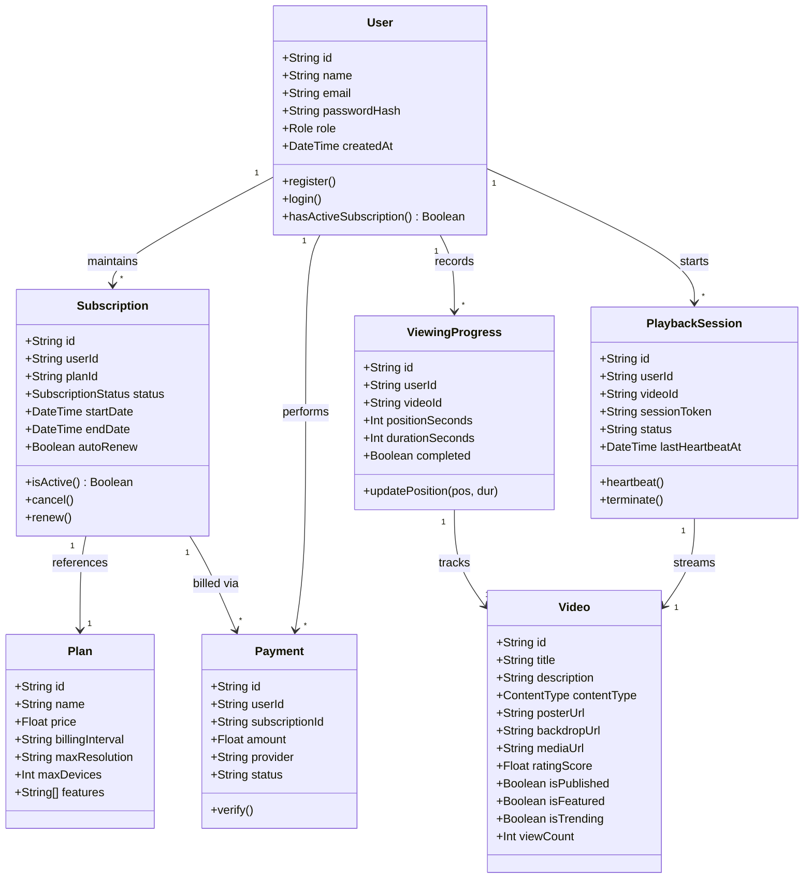
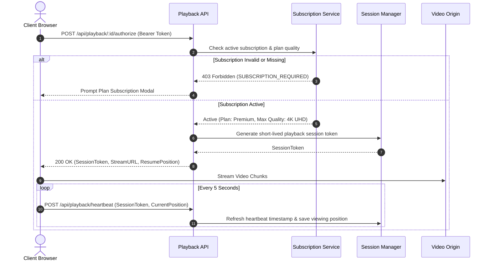

# REELFLIX — System Architecture & Design Document (HLD & LLD)

## 1. High-Level Design (HLD)

REELFLIX is architected as a modern, high-performance, resilient video streaming and subscription platform. The system separates concerns between client-side interactive presentation, secure edge/API routing, core micro-domain logic, transactional persistence, and content delivery networks.

---

## 2. Low-Level Design (LLD)

### UML Class & Domain Diagram

---

## 3. Playback Entitlement Security Flow

---

## 4. Scalability & Microservices Evolution
1. **API Gateway & Rate Limiting**: Production ingress uses NGINX or Envoy to rate-limit sensitive endpoints (e.g. 5 login attempts per minute).
2. **Video Transcoding Pipeline**: Videos uploaded to S3 trigger AWS Elemental MediaConvert / FFmpeg worker queues to produce multi-bitrate HLS streams (1080p, 720p, 480p).
3. **Redis Caching Layer**: Trending titles, home hero configurations, and user session tokens are cached in Redis with TTLs (e.g., 300s) to reduce database load by up to 90%.
