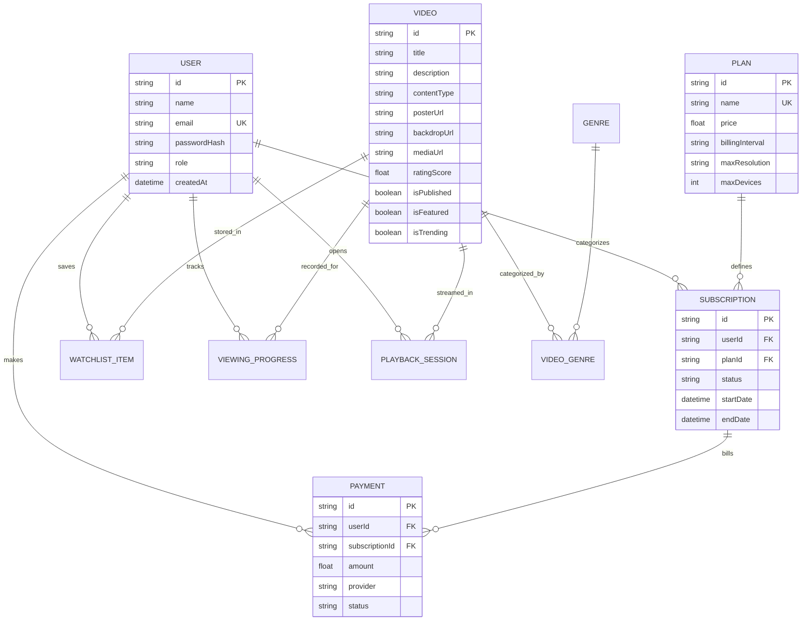

# REELFLIX — Database Schema & Data Modeling

The REELFLIX relational schema is designed with strict integrity constraints, cascade rules, indexing on search and filtering columns, and audit timestamps.

## Entity Relationship Overview

## Key Database Constraints & Performance Indexes
- `User.email`: Unique index for fast O(1) credential lookups and preventing duplicate registrations.
- `[WatchlistItem.userId, WatchlistItem.videoId]`: Unique compound constraint ensuring a user cannot add duplicate items to their personal list.
- `[ViewingProgress.userId, ViewingProgress.videoId]`: Unique compound constraint for atomic playback position updates.
- `[Video.isFeatured, Video.isPublished]`, `[Video.isTrending, Video.isPublished]`: Composite indexes for sub-millisecond retrieval of hero premiere banners and carousel rows.
